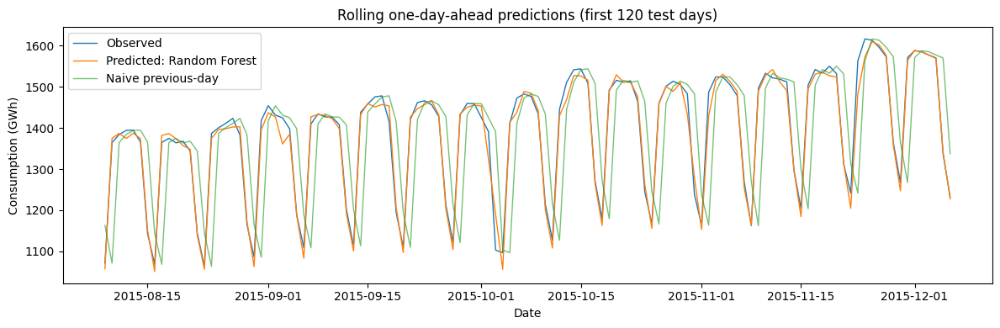

# Daily Electricity Consumption Forecasting

Comparison of five regression models against a previous-day naive baseline for **daily electricity consumption in Germany**. This is an educational data analytics and machine learning project implemented in Python and scikit-learn.

## Key result

On a chronological holdout of **876 days (2015-08-09 to 2017-12-31)**, **Random Forest**, selected using training-only time-series cross-validation, achieved **MAE 22.803 GWh**, compared with **101.663 GWh** for the previous-day naive baseline — a **77.6% reduction in MAE** for this evaluation setup.



*Plot: first 120 days of the test period. All reported test metrics use the complete 876-day holdout.*

## Data

- **Source:** [Open Power System Data — Germany daily time series (community GitHub mirror)](https://github.com/jenfly/opsd)
- **File loaded by notebook:** [`opsd_germany_daily.csv`](https://raw.githubusercontent.com/jenfly/opsd/refs/heads/master/opsd_germany_daily.csv)
- **Target:** `Consumption` (daily electricity consumption, GWh)
- **Features:** observed consumption from 1, 2 and 7 days earlier; day of week; month
- **Split:** first 80% chronologically for training (3,500 observations), final 20% for testing (876 observations), after feature construction

The CSV is downloaded at runtime; it is **not redistributed** in this repository. The upstream source and its license should be consulted for reuse of the underlying data.

## Method

1. Load the daily series, sort by date and create lag/calendar features.
2. Use a chronological train/test split (no random shuffling).
3. Compare Linear Regression, KNN, Random Forest, SVR and MLPRegressor.
4. Use 5-fold expanding-window `TimeSeriesSplit` on training data to select the best ML model by cross-validated MAE.
5. Evaluate all models and the previous-day naive baseline on the held-out test period with MAE, RMSE and R².

**Forecast horizon:** this is a **rolling one-day-ahead evaluation**. The true previous-day consumption is assumed available before each new prediction. It is **not** a forecast of the entire test period from one starting date.

## Results

| Model | CV MAE (GWh) | Test MAE (GWh) | Test RMSE (GWh) | Test R² |
|---|---:|---:|---:|---:|
| **Random Forest** | **32.518** | **22.803** | **41.166** | **0.935** |
| KNN | 35.841 | 25.675 | 45.145 | 0.921 |
| Linear Regression | 44.249 | 43.916 | 61.829 | 0.852 |
| SVR | 74.656 | 52.995 | 78.702 | 0.761 |
| MLP | 497.422 | 99.476 | 127.187 | 0.376 |
| Naive (previous day) | — | 101.663 | 149.231 | 0.141 |

Values are transcribed from the executed notebook included in this repository. The baseline has no CV score because it is not trained. Lower MAE/RMSE is better; higher R² is better.

## Run locally

Requires Python (tested by the author with **Python 3.9.13**), internet access for the data download, and VS Code with the Python and Jupyter extensions or JupyterLab.

```bash
python -m venv .venv
# Windows PowerShell:
.\.venv\Scripts\python.exe -m pip install -r requirements.txt
# macOS/Linux:
# .venv/bin/python -m pip install -r requirements.txt
```

Open `notebooks/energy-consumption-forecasting.ipynb`, select the `.venv` kernel and choose **Run All**. Dependencies are specified without strict version pins; minor differences in results may occur across package versions.

## Limitations

- The lag features for test dates use **actual prior-day observations**, not recursively predicted values.
- MLPRegressor reached its configured `max_iter=500` without convergence; its configuration was not tuned. Its results should be interpreted accordingly.
- The dataset comes from an external URL that could change or become unavailable.
- This is a comparative educational experiment, not a production forecasting service.

## Repository contents

```text
notebooks/energy-consumption-forecasting.ipynb  # code and executed outputs
images/forecast_comparison.png                   # visualization for README
requirements.txt                                 # Python dependencies
.gitignore                                       # local environment exclusions
```
